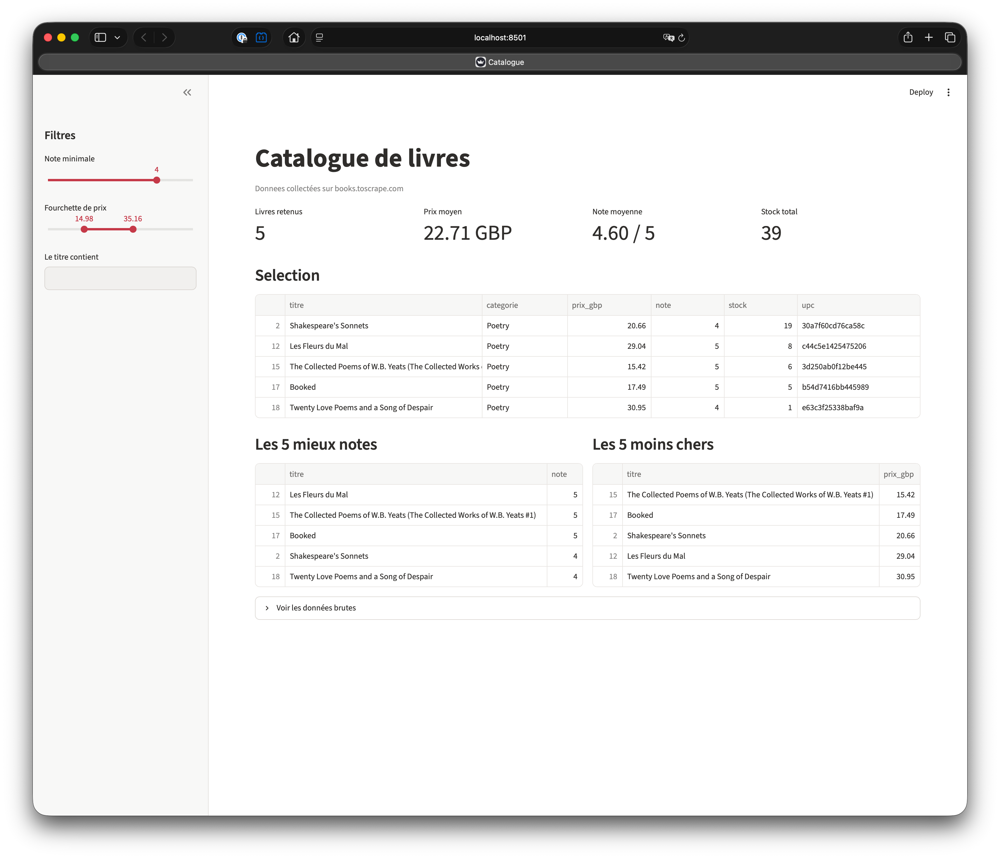

# Explorateur de catalogue

Application Streamlit pour explorer un catalogue de 19 livres de poésie
collectés sur books.toscrape.com : filtres par note, fourchette de prix
et titre, indicateurs recalculés sur la sélection, palmarès des mieux
notés et des moins chers.



## Lancer l'application

```bash
python3 -m venv .venv
source .venv/bin/activate
pip install -r requirements.txt
streamlit run app.py
```

L'application s'ouvre sur http://localhost:8501.